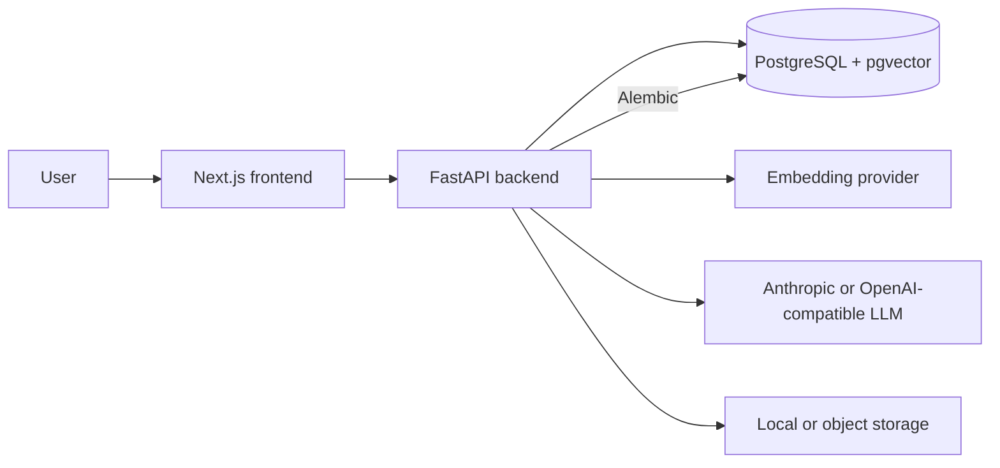

# ClosedAI

ClosedAI lets you ask questions across your own files and get answers that cite the exact page.

## The problem

Notes, course materials, research papers, and work documents are difficult to search in context. Copying excerpts into a general-purpose chat also risks losing source location and user privacy boundaries. ClosedAI keeps retrieval scoped to the signed-in user and selected unit, then provides page-linked citations from uploaded documents.

Chat runs on `claude-sonnet-4-5-20250929` via Anthropic with the default provider configuration.

## Screenshots

Screenshot placeholders for chat citations and the document library will be added when release captures are available.

## Live demo

No live demo is published in this repository. Run the self-hosted setup above to try ClosedAI locally.

## Features

- Upload PDF, DOCX, text, Markdown, and supported image files.
- Ask follow-up questions against documents in a selected unit.
- Stream answers and page-linked source citations.
- Choose Anthropic or an OpenAI-compatible LLM provider.
<<<<<<< HEAD
- Run Meta Llama models through any compatible OpenAI-format endpoint or hosted inference provider.
=======
>>>>>>> a36a6a81b058e21a51dab9728ab43c3c4109c859
- Use native tool calls or prefetch retrieval mode.
- Store embeddings locally or with a hosted embedding provider.
- Use local authentication or hosted Supabase authentication.
- Track weekly free credits, redeem codes, usage, premium days, and admin grants.
- Review conversation history and delete account data.

## Architecture



See [docs/ARCHITECTURE.md](docs/ARCHITECTURE.md) for details.

## How retrieval works

1. The backend extracts document text and page information.
2. Text chunks are embedded and stored with document, user, and unit identifiers.
3. Conversational follow-ups can be rewritten into standalone search queries.
4. Retrieval searches only chunks belonging to the authenticated user and selected unit.
5. Retrieved text is passed to the model as untrusted reference material.
6. Supported claims are returned with citations such as `[filename, page X]`.

## Security

- Retrieval is scoped by authenticated user and unit.
- Hosted startup rejects incomplete OpenAI-compatible provider settings.
- Provider keys and service credentials remain server-side.
- Hosted mode requires explicit public HTTPS CORS origins.
- Upload limits and API rate limits are enforced.
- Sentry configuration scrubs authorization headers and request bodies.
- Conversation history and account data are exposed through authenticated API routes.

## Self-host quick start

Requirements: Docker Compose, Node.js 20+, and an Anthropic API key or an OpenAI-compatible provider.

```bash
cp .env.example .env
# Configure provider credentials and database settings in .env.
docker compose up --build
```

The frontend is available at `http://localhost:3000` and the API at `http://localhost:8000`.

For direct backend development:

```bash
cd backend
C:\Projects\closedai\.venv\Scripts\python.exe -m pip install -r requirements.txt -r requirements-dev.txt
C:\Projects\closedai\.venv\Scripts\python.exe -m alembic upgrade head
C:\Projects\closedai\.venv\Scripts\python.exe -m uvicorn app.main:app --reload
```

For frontend development:

```bash
cd frontend
npm ci
npm run dev
```

## Hosted deployment summary

Provision PostgreSQL with pgvector, run Alembic migrations, deploy the FastAPI backend, and deploy the Next.js frontend with its public API URL. Configure HTTPS CORS origins, authentication, storage, embeddings, and provider credentials with server-side environment variables. Never expose provider keys or service-role keys through `NEXT_PUBLIC_*` settings.

## Environment variables

| Variable | Purpose | Placeholder |
|---|---|---|
| `MODE` | Deployment mode | `selfhosted` |
| `DATABASE_URL` | PostgreSQL connection | `YOUR_POSTGRESQL_DATABASE_URL` |
| `ANTHROPIC_API_KEY` | Anthropic chat and image reading | `YOUR_ANTHROPIC_API_KEY` |
| `ANTHROPIC_MODEL` | Anthropic model | `your-model-id` |
| `LLM_PROVIDER` | Anthropic or OpenAI-compatible provider | `anthropic` |
<<<<<<< HEAD
| `LLM_BASE_URL` | OpenAI-compatible API base URL, including Meta-compatible endpoints | `https://your-provider.example/v1` |
=======
| `LLM_BASE_URL` | OpenAI-compatible API base URL | `https://your-provider.example/v1` |
>>>>>>> a36a6a81b058e21a51dab9728ab43c3c4109c859
| `LLM_API_KEY` | OpenAI-compatible provider key | `YOUR_LLM_API_KEY` |
| `LLM_MODEL` | Configured chat model | `your-model-id` |
| `LLM_TIMEOUT_SECONDS` | Provider timeout | `60` |
| `LLM_MAX_TOKENS` | Maximum response tokens | `1024` |
| `LLM_TOOL_MODE` | Native tools or prefetch | `native` |
| `EMBEDDING_PROVIDER` | Local, Voyage, or OpenAI embeddings | `local` |
| `OPENAI_API_KEY` | OpenAI embeddings | `YOUR_EMBEDDING_API_KEY` |
| `VOYAGE_API_KEY` | Voyage embeddings | `YOUR_EMBEDDING_API_KEY` |
| `AUTH_PROVIDER` | No authentication or Supabase | `none` |
| `SUPABASE_URL` | Supabase project URL | `https://YOUR-PROJECT-REF.supabase.co` |
| `SUPABASE_ANON_KEY` | Public browser key | `YOUR_SUPABASE_ANON_KEY` |
| `SUPABASE_SERVICE_KEY` | Server-only Supabase key | `YOUR_SUPABASE_SERVICE_KEY` |
| `STORAGE_PROVIDER` | Local or Supabase storage | `local` |
| `NEXT_PUBLIC_API_URL` | Public backend URL | `http://localhost:8000` |
| `NEXT_PUBLIC_AUTH_MODE` | Frontend authentication mode | `none` |
| `CORS_ORIGINS` | Allowed frontend origins | `http://localhost:3000` |
| `ADMIN_EMAILS` | Hosted administrator emails | `admin@example.com` |
| `SENTRY_DSN` | Optional backend monitoring | `https://example.invalid/1` |

Additional optional settings are listed in [.env.example](.env.example).

<<<<<<< HEAD
### Meta model configuration

ClosedAI can use a Meta Llama model through an OpenAI-compatible inference endpoint. Configure the endpoint URL and model identifier with:

```text
LLM_PROVIDER=openai_compatible
LLM_BASE_URL=https://your-meta-compatible-provider.example/v1
LLM_API_KEY=YOUR_LLM_API_KEY
LLM_MODEL=your-meta-model-id
LLM_TOOL_MODE=native
```

For providers whose tool calling is unreliable, use `LLM_TOOL_MODE=prefetch`. Anthropic remains the default provider unless `LLM_PROVIDER` is changed.

=======
>>>>>>> a36a6a81b058e21a51dab9728ab43c3c4109c859
## Limitations

- Retrieval quality depends on extraction, chunking, embeddings, and the selected model.
- Image reading uses the Anthropic vision path and requires `ANTHROPIC_API_KEY`.
- Hosted authentication, storage, email, and provider integrations require external configuration.
- Process-local API limiters do not coordinate multiple application instances.
- The system does not perform fact verification against sources outside the uploaded documents.

## Safety note

Answers can be incomplete, incorrect, or unsupported. Verify important statements against the cited source documents. Upload files only when you have permission and understand the deployment's storage and retention practices.

## Roadmap

- Compare additional embedding and reranking strategies.
- Improve citation and source previews.
- Expand provider compatibility coverage.
- Add optional shared rate-limit storage.
- Improve multilingual extraction.
- Add retrieval quality evaluation datasets.

## Contributing

See [CONTRIBUTING.md](CONTRIBUTING.md). Add tests for behavior changes and keep configuration free of credentials.

## License

MIT. See [LICENSE](LICENSE).

Built with AI-assisted development (Claude, GitHub Copilot).

This is the open-source edition of a larger project; the repository history was reset when it was separated from private deployment configuration.
