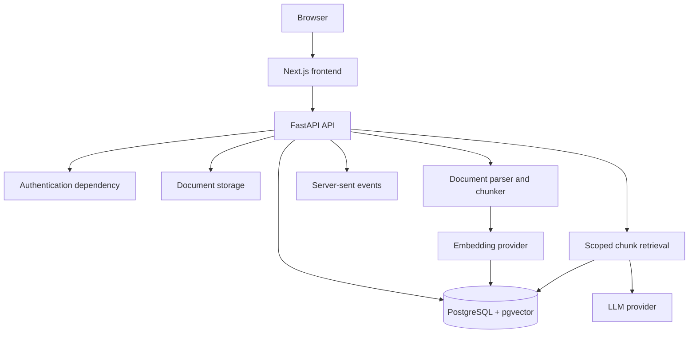

# Architecture

ClosedAI is a Next.js and FastAPI application backed by PostgreSQL with pgvector.

## Request flow

1. Authentication identifies the current user.
2. The API verifies that the requested unit belongs to that user.
3. Uploaded documents are extracted, split into chunks, embedded, and stored.
4. A chat request retrieves only chunks belonging to the authenticated user and selected unit.
5. The agent passes retrieved text and conversation context to Anthropic or an OpenAI-compatible provider.
6. Text, status, sources, usage, and completion events are streamed over SSE.
7. The assistant message and sources are stored with the conversation.

## Provider layer

The configured provider implements normalized text, tool-call, usage, and stop-reason events. Anthropic is the default. OpenAI-compatible providers support streamed function calling and native tool calls. `LLM_TOOL_MODE=prefetch` rewrites the question, performs scoped retrieval, and supplies numbered sources without native tool calls.

Search scope is always supplied by authenticated request context rather than model-generated scope fields. Retrieved document text is treated as untrusted reference data.

## Storage

The default local deployment uses PostgreSQL for application state and the local filesystem for uploads. Hosted deployments can use the supported object-storage integration. Alembic manages the database schema.

## Security boundaries

- User and unit ownership checks are performed on API routes and retrieval.
- Server credentials stay outside frontend environment variables.
- Hosted startup validates required provider configuration.
- Provider errors do not expose API keys.
- Upload size, text-size, and API-rate limits are configurable.
- Process-local rate limiting should be replaced with shared storage for scaled deployments.
